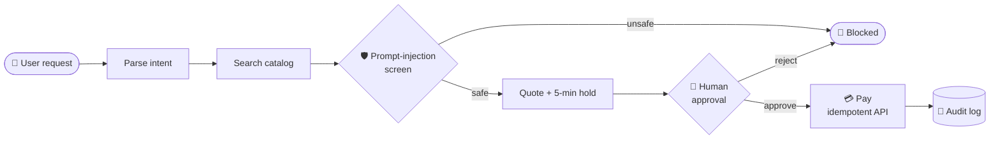

  

  
  
  

---
 
### 👋 About me
 
I build **AI agents that can be trusted with real actions**, and the backend systems that keep them safe.
 
- 🎓 Final-year **B.Tech CSE** at **PES University**, Bangalore (graduating 2027)
- 🤖 Focused on **Agentic AI, LLMs and RAG**, built on solid **backend fundamentals** (Java, Spring Boot, FastAPI, SQL)
- 🔬 **Summer Research Intern at CDSAML, PES University**: studied how image compression affects chest X-ray AI models (CNN vs Vision Transformer vs MLP)
- 🏆 **1st place, Fin-a-thon** (38 teams) · built for the **Razorpay AI Buildathon** and **Honeywell Eco-Loop**
- 🧩 **200+ LeetCode** problems solved in C++
- 🌱 Currently exploring: **voice AI** and real-time speech pipelines
---
 
### 🧠 How I build agents
 
My Razorpay Buildathon agent shops and pays for a user, so every step has a guardrail:
 

 
---
 
### 🚀 Featured projects
 
| Project | What it does | Built with |
|---|---|---|
| 🛒 **[Agentic Commerce App](REPLACE_WITH_REPO_LINK)** | LangGraph agent that shops & pays with human approval, spend limits, prompt-injection screening, idempotent APIs and **190+ tests** | Python · LangGraph · FastAPI · SQL · pytest |
| 🎯 **[PrepAIred](REPLACE_WITH_REPO_LINK)** | Capstone: adaptive interview prep with a **PPO** difficulty policy and an SBERT + FAISS grader (**0.84** correlation with experts) | PyTorch · SBERT · FAISS · Docker |
| 💻 **[Real-Time Collaborative Coding Platform](https://github.com/as-45/CN-Project)** | Multi-user code editor where every keystroke syncs instantly across rooms | React · Node.js · Socket.io |
| 🔍 **[Repo Breaker](REPLACE_WITH_REPO_LINK)** | Paste a GitHub repo and ask questions about its code (RAG over source files) | FastAPI · SBERT · FAISS · React |
| 🗺️ **[Tourist Recommendation System](REPLACE_WITH_REPO_LINK)** | Personalised travel recommendations on a normalised MySQL schema | Flask · MySQL · REST |
 
---
 
### 🛠️ Tech stack
 
**AI & LLMs**

  
  
  
  
  
  

**Backend**

  
  
  
  
  
  

**Tools & frontend**

  
  
  
  
  
  

---
 

  <i>Always happy to talk about agents, backend systems, or a good DSA problem. Say hi! 👋</i>

 
